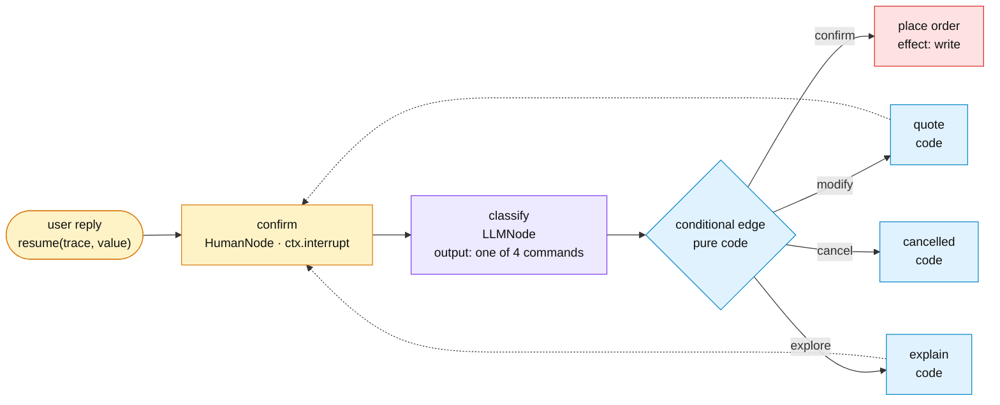
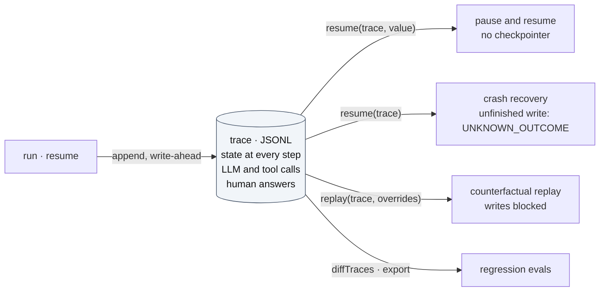
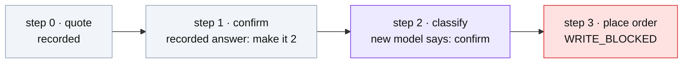

# taugraph (τ)

[](https://github.com/wangcao-hub/taugraph/actions/workflows/ci.yml) [](https://www.npmjs.com/package/taugraph) [](./LICENSE)

**Minimal typed agent graph harness.**

> Pi is a loop. τ is the trajectory.

A tiny kernel that runs a graph of nodes over one schema-validated, immutable state, and writes every step to an append-only, replayable transcript. LLM calls, tools, sub-agents and humans are plugin nodes. The kernel knows nothing about them.

[中文文档](./README.zh-CN.md) · [Design notes](./docs/design.md) · [Trace format](./docs/trace-format.md)

```
npm install taugraph zod     # or any Standard Schema library: valibot, arktype, ...
```

## Why τ

In reinforcement learning, τ is the standard symbol for a trajectory: the sequence of states and actions an agent goes through. A taugraph run is exactly that, a path through the graph with a state snapshot at every step, recorded so it can be replayed. The name is also a nod to [Pi](https://pi.dev), whose minimal, append-only design taugraph follows (and to τ = 2π).

## Why put the flow in code

If a model decides every step and gets each one right 95% of the time, a 3-step flow succeeds about 86% of the time and a 5-step flow about 77%. Better prompts move 95% to 97%, never to 100%. taugraph takes everything that can be written down in advance (what runs next, when to stop and ask, which calls change the world) out of the model and into a typed graph. The model is left with what only it can do, such as understanding a reply and picking one of a few allowed commands.

## How it works

A model is one kind of node among others. It writes a value into state; code reads that value and decides what happens next.



<sub>The graph of [`examples/checkout.ts`](./examples/checkout.ts). Yellow waits for a person. Purple is the only place a model runs, and its output must parse as one of four commands. Blue is code you can unit-test. Red changes the outside world, so replays block it unless you allow it.</sub>

Everything taugraph does after a run is computed from one append-only log. There is no second store to keep in sync.



## What's new in the design

1. **The trace is the checkpoint.** Pause, resume and crash recovery are all derived from the append-only log, so the kernel has no checkpointer, thread store or storage interface. Store the JSONL wherever you like. (LangGraph's `interrupt()` needs a checkpointer and a thread id.)
2. **Counterfactual replay.** A replayed step reuses its recorded output only when it receives exactly the recorded input state; any step that sees a different state runs live. "What if step 2 had used another model?" is one call, and the steps before the first change cost nothing. (LangGraph's replay re-executes every node after the checkpoint, LLM and API calls included. Durable-execution engines such as Temporal treat a divergence from history as a non-determinism error.)



<sub>The checkout conversation replayed with an over-eager classifier. Steps 0 and 1 come from the trace, including the person's answer. The new model reads "make it 2" as a confirmation, so the run would now place an order; the replay stops there instead.</sub>

3. **Replays don't repeat side effects unless you say so.** `effect: "write"` is part of the node, not a convention. Replays, and resumed replays, refuse to run a write node live unless you override it or pass `allowWrites: true`. A write that was running when the process died becomes `UNKNOWN_OUTCOME`, never a silent retry.
4. **Conversations become test cases.** Human answers are stored in the trace as inputs. Replaying a human-in-the-loop run needs no human: each `ctx.interrupt` gets its recorded answer as long as the step sees the recorded state. (LangGraph fires interrupts again on replay.)
5. **Models choose, code routes.** Routers are synchronous functions of the state; an async router is rejected at run time. A model can only write a schema-checked value into state, such as one of four commands, and the edge reads it. A router cannot await a model call, so model decisions happen in nodes, where the trace records them.

## Where it sits

|                 | Pi                              | LangGraph                                 | taugraph                                      |
| --------------- | ------------------------------- | ----------------------------------------- | --------------------------------------------- |
| Kernel          | single-agent loop (LLM ↔ tools) | stateful graph with channels and reducers | graph scheduler + typed state                 |
| Orchestration   | extension                       | core                                      | core                                          |
| State           | message transcript              | channels, checkpoint per step             | one schema-checked, frozen JSON object        |
| Pause for input | the conversation itself         | `interrupt()` + a checkpointer            | `ctx.interrupt()`, resumed from the trace     |
| Log             | append-only session             | checkpoints in a persistence backend      | append-only event stream with state snapshots |
| LLM / tools     | built in                        | bring your own, often LangChain           | plugin nodes, none in the kernel              |
| Runtime deps    | provider SDKs                   | LangChain core and friends                | **none**                                      |

## Rules of the kernel

1. The kernel runs graphs, validates state and appends to the trace. It has **no LLM, no tools, no RAG, no memory**.
2. State has a schema ([Standard Schema](https://standardschema.dev): Zod ≥ 3.24, Valibot ≥ 1, ArkType ≥ 2).
3. The trace is append-only. Events are frozen and never edited.
4. A run is a serializable trace. Replay it at any time, with any node or model swapped.
5. No hidden magic. Side effects are recorded as explicit events, and nodes that change the world declare `effect: "write"` so a replay never repeats them.
6. Sync first, async optional. `runSync` never touches a Promise; no async runtime is assumed.
7. Zero runtime dependencies. Works in Node ≥ 22, Bun, Deno and browsers (CI runs Node 22 and 24; Bun, Deno and Chrome were checked by hand for 0.2.0).

These are enforced by tests (`test/architecture.test.ts`), not only by convention.

## Quick start

```ts
import { createGraph, diffTraces, toJSONL } from "taugraph";
import { CodeNode, LLMNode, type LLMModel, textOf } from "taugraph/nodes";
import { z } from "zod";

const State = z.object({
  question: z.string(),
  raw: z.string().nullable().default(null),
  final: z.string().nullable().default(null),
});

// Any provider fits this contract. See examples/adapters/openai-compatible.ts.
const model: LLMModel = {
  id: "mock:echo",
  complete: (req) => ({ content: `echo: ${textOf(req.messages.at(-1)?.content ?? "")}` }),
};

const graph = createGraph(State, {
  start: "fetch",
  nodes: {
    fetch: CodeNode((s) => ({ ...s, raw: `notes about ${s.question}` })),
    answer: LLMNode({
      model,
      prompt: (s) => `Use these notes: ${s.raw}\nQuestion: ${s.question}`,
      update: (s, text) => ({ ...s, final: text }),
    }),
  },
  edges: [{ from: "fetch", to: "answer" }],
  endNodes: ["answer"],
});

const { state, trace } = await graph.run({ question: "What is agent orchestration?" });
const jsonl = toJSONL(trace); // one event per line, ready for a file or an eval harness

// Replay with the answer node mocked. `fetch` reuses its recorded output.
const replay = await graph.replay(trace, {
  overrides: { answer: CodeNode((s) => ({ ...s, final: "mock answer" })) },
});
console.log(diffTraces(trace, replay.trace)); // { equal: false, firstDivergence: { step: 1, ... }, changedKeys: ["final"] }
```

State, input and node ids are all inferred from the schema and `nodes`. A typo in an edge, or a node that returns the wrong shape, is a compile error.

With TypeScript older than 5.9, a node that returns a literal value (for example `outcome: "ordered"` for a union field) is not inferred; write `CodeNode<State>(...)` there. TypeScript 5.9 and 7 need no annotation.

## Concepts

### State

One object, described by a schema. Every node receives the current state **deeply frozen** and returns a **new** state. The kernel validates every output against the schema and fails with an explicit error:

```ts
error.code; // "INVALID_STATE"
error.message; // Node "answer" (step 1) returned invalid state:
//   - final: Invalid input: expected string, received number
```

State must be plain JSON (no `Date`, `Map`, class instances). That is what makes a trace loaded from disk replay exactly like one held in memory.

### Node

```ts
type Node<S> = (state: S, ctx: RunContext) => S | Promise<S>;

interface RunContext {
  meta: { runId: string; nodeId: string; step: number; attempt: number; recovered: boolean };
  signal: AbortSignal; // pass it to fetch / model clients
  trace: { append(event: PluginEvent): void }; // record a side effect
  interrupt<T>(request?: unknown): T; // pause the run until resume(trace, value)
}
```

Any function with this signature is a node. The context deliberately contains no models, tools or stores; nodes bring their own dependencies.

### Graph

Start node, plain edges, conditional edges, end nodes. That is all.

```ts
conditionalEdges: [{ from: "search", route: (s) => (s.docs ? "answer" : "rewrite"), targets: ["answer", "rewrite"] }];
```

The graph is checked when it is built: unknown nodes, dead ends, end nodes with outgoing edges and fan-out (two edges leaving one node) are rejected. Routers are pure and synchronous; if routing needs an LLM, do that in a node and route on its result. `maxSteps` (default 100) stops runaway loops.

### Trace

An append-only list of frozen events:

```
run_start → enter → [llm_call | tool_call | ...] → exit → enter → pause → run_end(paused)
          → resume → enter → exit → ... → run_end
```

`enter` carries the input state, `exit` the output state, so the stream doubles as a sequence of snapshots. Nodes add their own events with `ctx.trace.append`. Kernel event types are reserved.

`run(input, { onEvent })` hands every event to your sink before the run continues. If the sink throws, the run stops with `SINK_FAILED`, so no step runs without being logged. Full spec: [docs/trace-format.md](./docs/trace-format.md).

### Pause and resume

A node calls `ctx.interrupt(request)` to wait for something from outside: a human approval, a button click, a webhook. The run returns `{ status: "paused", pending: { nodeId, step, request } }`. Store the trace anywhere, exit the process, and later:

```ts
const result = await graph.resume(trace, value); // same runId, appended to the same trace
```

On resume the waiting node runs again from the top and `ctx.interrupt` returns `value`; code before the call runs twice, so keep it free of side effects. The n-th `interrupt` in a node gets the n-th value, and each visit of a looping node gets its own values. **The trace is the checkpoint**: no database or checkpointer is involved. Resume a paused trace once; to reject stale answers (an old button clicked twice), compare `pending.step` with the latest trace you stored.

`resume(trace)` without a value also recovers a trace that ended mid-run, for example after a crash: it continues after the last finished step. If a `write` node was running at that moment, its outcome is unknown, so resume stops with `UNKNOWN_OUTCOME`. Check the outside system, then call `resume(trace, undefined, { allowWrites: true })`; the node sees `ctx.meta.recovered === true`.

### Effects

```ts
CodeNode(placeOrder, { effect: "write" });
```

`write` marks a node whose call changes the outside world. It is recorded on `enter` events, and replay refuses to run it live (`WRITE_BLOCKED`) unless you override it with a mock or pass `allowWrites: true`. This also holds when you resume a replay that paused. Undeclared nodes count as `read`.

### Replay

```ts
graph.replay(trace, { overrides?, mode?: "recorded" | "live", allowWrites? })
```

The run restarts from the recorded input under a new runId. In `recorded` mode (default), a node that is not overridden and sees exactly the recorded input state reuses its recorded output, with no side effects. As soon as the state diverges, nodes run live. `live` re-executes everything. Values delivered by `resume` are fed back to `ctx.interrupt` whenever a step sees the recorded state, so a human-in-the-loop conversation replays without anyone answering again. `write` nodes are blocked as described above. Use `diffTraces(a, b)` to find the first diverging step and the changed state keys.

Typical uses: swap a model and compare answers, mock a flaky tool, rerun a failed production trace locally after a fix, build regression evals from recorded traces.

### Errors and retries

Every failure is a `TaugraphError` with a `code` (`INVALID_GRAPH`, `INVALID_STATE`, `INVALID_ROUTE`, `NODE_FAILED`, `MAX_STEPS`, `ABORTED`, `ASYNC_IN_SYNC_RUN`, `INVALID_TRACE`, `INVALID_EVENT`, `WRITE_BLOCKED`, `UNKNOWN_OUTCOME`, `NOT_RESUMABLE`, `SINK_FAILED`), plus `nodeId`, `step`, schema `issues`, the original `cause`, and the `trace` up to the failure. Nodes can opt into retries: `CodeNode(fn, { retry: { maxAttempts: 3 } })`. Each failed attempt is an `error` event.

## Plugin nodes (`taugraph/nodes`)

| Node        | What it does                                                                                                    |
| ----------- | --------------------------------------------------------------------------------------------------------------- |
| `CodeNode`  | Deterministic state transformation.                                                                             |
| `LLMNode`   | Calls an `LLMModel` (tools included), records an `llm_call` event, optionally parses JSON output with a schema. |
| `HumanNode` | Pauses for an answer via `ctx.interrupt`, validates it with a schema, asks again if invalid.                    |

`LLMNode` only defines the call contract (`{ id, complete(request, { signal }) }`); bring OpenAI, Ollama or anything else through a small adapter. An OpenAI-compatible one is in [`examples/adapters`](./examples/adapters/openai-compatible.ts). Messages can carry images; see [Images](#images).

Writing your own node type takes one call to `defineNode`:

```ts
import { defineNode } from "taugraph";

interface Tool {
  name: string;
  run(input: unknown, signal: AbortSignal): Promise<unknown>;
}

export const ToolNode = <S>(tool: Tool, apply: (s: S, out: unknown) => S) =>
  defineNode<S>(
    async (state, ctx) => {
      const output = await tool.run(state, ctx.signal);
      ctx.trace.append({ type: "tool_call", input: { tool: tool.name }, output });
      return apply(state, output);
    },
    { kind: "tool" },
  );
```

## Agent (`taugraph/agent`)

`createAgent` turns the model ↔ tools loop into an ordinary taugraph graph. Each model call and each tool call is a step of its own, so everything above applies to every single call: it is in the trace, replay reuses it, a replay never repeats a write, a crash mid-write stops with `UNKNOWN_OUTCOME`, and a call can wait for a human.

```ts
import { createAgent, tool } from "taugraph/agent";
import { z } from "zod";

const weather = tool({
  name: "weather",
  description: "Today's weather for a city",
  input: z.object({ city: z.string() }), // validates arguments and becomes the JSON Schema the model sees
  run: ({ city }) => `${city}: cloudy, -2~5°C`,
});

const addTodo = tool({
  name: "add_todo",
  effect: "write", // runs in a write step
  input: z.object({ text: z.string() }),
  run: ({ text }) => `added "${text}"`,
});

const agent = createAgent({
  model, // any LLMModel whose adapter supports tools
  tools: [weather, addTodo],
  system: "You help with the day.",
  approve: (call, t) => (t.effect === "write" ? "ask" : "run"),
});

const result = await agent.run({ messages: [{ role: "user", content: "What should I wear today?" }] });
// paused on add_todo: result.pending.request is { type: "tool_approval", call, effect: "write" }
const done = await agent.resume(result.trace, true); // or false, or { approved: false, reason }
console.log(done.state.final);
```

```
think ──a read call──▶ act ───────┐
  ▲   ──a write call─▶ act_write ─┤  more calls: act / act_write
  └───────────────────────────────┘  none left: think
think ──no calls, or maxRounds──▶ finish
```

- The state is `{ messages, pending, rounds, final, stop }`, validated by a built-in Standard Schema (no validator needed).
- Tool definitions follow MCP (`name`, `description`, `inputSchema` as JSON Schema). A tool's JSON Schema comes from `inputSchema` if given, else from `input` through [Standard JSON Schema](https://standardschema.dev/json-schema) (Zod 4, Valibot, ArkType).
- Invalid arguments, unknown tools, unreadable arguments and thrown errors go back to the model as error results; the loop continues.
- `maxRounds` (default 8) bounds model calls; at most 32 calls run per reply. Each tool run is a `tool_call` event.
- Models: the call contract gained optional `tools`, `toolChoice` and `toolCalls`, and `tool` messages. An adapter that maps `role` itself needs a `tool` branch. The [OpenAI-compatible adapter](./examples/adapters/openai-compatible.ts) translates them. `pnpm example:agent` runs the whole thing. Tool results may carry images (see [Images](#images)).

## Images

User messages and tool results can carry images. Their `content` is then an array of parts, in order; `system` and `assistant` messages stay text.

```ts
const question: ChatMessage = {
  role: "user",
  content: [
    { type: "text", text: "Which of these is the receipt?" },
    { type: "image", data: base64, mimeType: "image/png" }, // the bytes, in base64
    { type: "image", url: "media:9f2c" }, // or a reference the adapter reads when it calls the model
  ],
};
```

- A URL may be `https:`, `data:` or a reference of your own. The trace stores the state at every step and every request, so a base64 image is stored again and again, while a reference costs a few bytes. In `recorded` replay, a step that sees its recorded state reuses its recorded result, so a reference only has to resolve for steps that run again.
- Tools return images the same way: `run: () => ({ content: [{ type: "text", text: "the page" }, { type: "image", url: "media:shot1" }] })`.
- An MCP tool result can be returned as it is when it holds text and image blocks; other blocks, such as audio or resources, fail the run, so convert them first.
- For adapters, `resolveImages(messages, resolve)` turns `data:` URLs into base64 and every other URL into what `resolve` returns. An adapter that sends text only uses `textOf(m.content)`, which throws on images unless given `{ imagePlaceholder }`, so a model never answers about a picture it did not get.
- The [OpenAI-compatible adapter](./examples/adapters/openai-compatible.ts) sends http(s) and `data:` URLs as they are and reads the rest with `resolveImage`. OpenAI's tool messages take text only, so it moves tool images into a user message right after them.

```ts
const model = openAICompatible({
  baseURL: "https://api.openai.com/v1",
  model: "gpt-4o-mini",
  resolveImage: async (url) => {
    const id = /^media:([\w-]+)$/.exec(url)?.[1];
    if (!id) throw new Error(`Unknown image reference: ${url}`);
    return { type: "image", mimeType: "image/png", data: (await readFile(`media/${id}.png`)).toString("base64") };
  },
});
```

## Reasoning models

`reasoning` on a request says how much the model should think first: `"off"`, `"minimal"`, `"low"`, `"medium"`, `"high"`, `"xhigh"` or `"max"`. Leave it out and the adapter sends nothing, so the model uses its default. Adapters map the level to the provider's setting and round to the nearest level the model has; for providers that take a token budget, the adapter turns levels into budgets.

```ts
const agent = createAgent({ model, tools, reasoning: "high" }); // every model call in the run
```

- Replies carry what the model thought in `response.reasoning` (`{ text, signature?, redacted? }[]`) and its token count in `usage.reasoningTokens`, which is part of `outputTokens`. Both are in the `llm_call` event.
- Some providers refuse the next request of a tool loop unless the model's earlier thinking comes back unchanged: DeepSeek V4 (`reasoning_content`), Claude (signed thinking blocks) and Gemini 3 (a `thoughtSignature` on each tool call, kept in `ToolCall.signature`). The agent stores reasoning and signatures in the assistant messages it writes, so the next round sends them.
- A signature is only valid for the model that wrote it, so every assistant message the agent writes records `model`, the `LLMModel.id`. Adapters send reasoning and signatures back only when `m.model` is their own `id`, so a replay that swaps the model never sends one model's signatures to another.
- The [OpenAI-compatible adapter](./examples/adapters/openai-compatible.ts) sends `reasoning_effort` by default (`"off"` as `"none"`), reads `reasoning_content` or `reasoning` from replies, and sends its own `reasoning_content` back. The default sends the level as it is; if a model refuses a level, map it in `reasoningParams`. Providers with their own switch take `reasoningParams`:

```ts
// DeepSeek V4: a thinking switch, plus low, high or max
const deepseek = (level: ReasoningLevel) =>
  level === "off"
    ? { thinking: { type: "disabled" } }
    : {
        thinking: { type: "enabled" },
        reasoning_effort:
          level === "minimal" || level === "low" ? "low" : level === "xhigh" || level === "max" ? "max" : "high",
      };
// Qwen and vLLM
const qwen = (level: ReasoningLevel) => ({ chat_template_kwargs: { enable_thinking: level !== "off" } });

const model = openAICompatible({
  baseURL: "https://api.deepseek.com",
  model: "deepseek-flash",
  reasoningParams: deepseek,
});
```

## Integrations

| Package                                                     | Use it to                                                                                                                   |
| ----------------------------------------------------------- | --------------------------------------------------------------------------------------------------------------------------- |
| [taugraph-mcp](https://github.com/wangcao-hub/taugraph-mcp) | Serve flows as MCP tools to any MCP client: Claude, Cursor, Kiro, AgentScope Java and others. `npx -y taugraph-mcp ./flows` |
| [taugraph-pi](https://github.com/wangcao-hub/taugraph-pi)   | Run flows as tools inside the [Pi](https://pi.dev) coding agent. `pi install npm:taugraph-pi`                               |

Both keep the trace format, so runs recorded through them can be replayed and diffed with this package.

## Not in the kernel, on purpose

Persistence backends, distributed workers, parallel nodes, nested subgraphs, built-in tools, memory, vector stores, visual editors, event routing, triggers and schedulers. Parallel calls inside one step are fine: use `Promise.all` in a node. Some will arrive as separate plugin packages; none will enter the kernel.

## Roadmap

- `taugraph/tools`: shell and filesystem tool nodes
- `taugraph/subagent`: delegate to external agents (ACP, Pi instances)
- `taugraph/compact`: trace and state compaction
- `taugraph/tui`: terminal trace viewer

## Development

```
pnpm install
pnpm check          # typecheck + lint + test
pnpm build
pnpm example:rag       # retrieval -> answer with a retry loop, JSONL trace, replay
pnpm example:checkout  # human in the loop: pause/resume, LLM picks a command, replay never re-orders
```

Set `TAUGRAPH_BASE_URL` and `TAUGRAPH_MODEL` (and `TAUGRAPH_API_KEY` if needed) to run the examples against a real OpenAI-compatible endpoint, e.g. Ollama at `http://localhost:11434/v1`.

See [CONTRIBUTING.md](./CONTRIBUTING.md).

## License

[MIT](./LICENSE)
